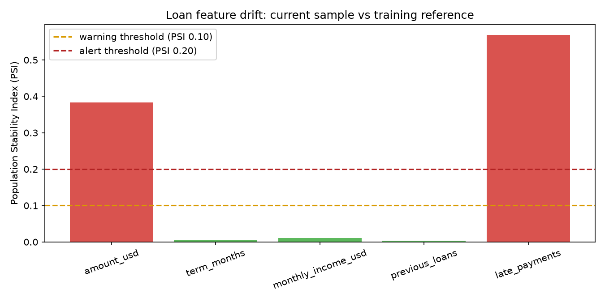

# Loan default model experiment report

Date: 2026-11-09

## Experiment

Ran six candidates on the same stratified 80/20 split (seed 42), using a 0.50 classification threshold. Precision, recall, and ROC AUC are test-set metrics.

| Candidate | Recall | Precision | ROC AUC | MLflow run |
|---|---:|---:|---:|---|
| Logistic regression, C=0.05 | 0.862 | 0.639 | 0.927 | [run 08fd0fb6](http://127.0.0.1:5000/#/experiments/1/runs/08fd0fb618b94c4184734a7202cc5a7c) |
| Logistic regression, C=0.1 | 0.853 | 0.637 | 0.927 | [run b33a362f](http://127.0.0.1:5000/#/experiments/1/runs/b33a362fcbd24c79a6cefe196ea4ed57) |
| Logistic regression, C=1.0 | 0.853 | 0.637 | 0.927 | [run 4f5b86ab](http://127.0.0.1:5000/#/experiments/1/runs/4f5b86ab9ff145c69774bddb58bdd221) |
| Random forest, depth=4 | 0.832 | 0.694 | 0.922 | [run da14c014](http://127.0.0.1:5000/#/experiments/1/runs/da14c014eb784a069b1c343d65884829) |
| Random forest, depth=8 | 0.815 | 0.716 | 0.928 | [run 4fa30aa5](http://127.0.0.1:5000/#/experiments/1/runs/4fa30aa51d364ad997f15ec64e209591) |
| Random forest, unlimited depth | 0.806 | 0.725 | 0.925 | [run ad790bee](http://127.0.0.1:5000/#/experiments/1/runs/ad790bee8e48429da41bb6e8fefaf7a8) |

## Promotion decision

I chose the logistic-regression candidate with C=0.05 as champion because, for a loan-default screening workflow, missing a likely default is the more costly error, and it has the highest recall at 0.862 while retaining 0.639 precision and 0.927 AUC. The random-forest depth-8 candidate is the challenger: its 0.928 AUC is marginally higher and its 0.716 precision is materially better, but its recall is 0.815. The champion therefore better prioritizes identifying default risk; the challenger remains available for continued comparison. See the [champion run](http://127.0.0.1:5000/#/experiments/1/runs/08fd0fb618b94c4184734a7202cc5a7c) and [challenger run](http://127.0.0.1:5000/#/experiments/1/runs/4fa30aa51d364ad997f15ec64e209591).

## Registry

Registered both candidates under `loan-default`. Alias `champion` points to version 1 (run `08fd0fb618b94c4184734a7202cc5a7c`); its version description records the recall-based selection and all three metrics. Alias `challenger` points to version 2 (run `4fa30aa51d364ad997f15ec64e209591`); its description records its alternative-model/AUC rationale and metrics. FastAPI loads `models:/loan-default@champion` at startup rather than a local model file or fixed version.

## Serving and integration

All three programs were started and checked:

- MLflow tracking/registry: `http://127.0.0.1:5000` — `/health` returned HTTP 200.
- MLflow scoring server: `http://127.0.0.1:5001` — `/health` returned HTTP 200.
- FastAPI: `http://127.0.0.1:8000` — `/health` returned `{"status":"ok","model_version":"1"}`.

For applicant `{amount_usd: 1500, term_months: 12, monthly_income_usd: 350.0, previous_loans: 1, late_payments: 0}`, MLflow `/invocations` returned probability `0.10312231230129174`; FastAPI `/api/v1/predictions` returned `0.103`. The difference is `0.000122`, due to FastAPI's three-decimal response rounding. A scoring request missing the required `late_payments` column was rejected with HTTP 400 (`INVALID_PARAMETER_VALUE`) by MLflow signature enforcement.

## Drift monitoring

`monitor.py` compared 1,000 current synthetic records with the 5,000-record training reference. The chart uses PSI <0.10 as stable, 0.10–<0.20 as a warning, and >=0.20 as an alert. `amount_usd` scored 0.384 and `late_payments` 0.569, both alerting; all other features scored below 0.012. The warning and alert thresholds are therefore set at PSI 0.10 and 0.20, respectively.

## Rollback verification and tests

Moved `champion` to version 2, restarted FastAPI, and verified `/health` returned model version `2`. Restored the alias to version 1, restarted FastAPI, and verified `/health` returned model version `1`. The regression suite passed: `5 passed`.
